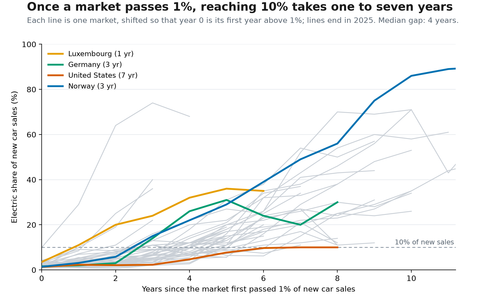
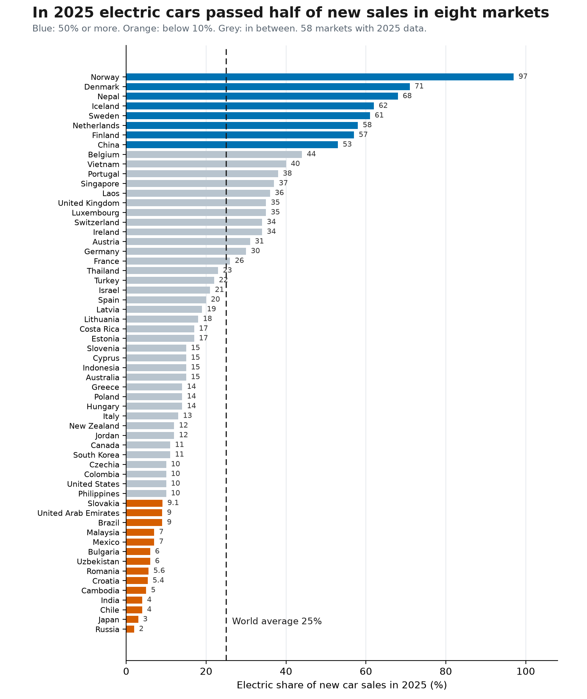

# How fast do car markets switch to electric?

A small analysis of the share of new cars that are electric, across 60 national markets and 15 years.

## The question

Norway sells almost only electric cars; Japan still sells almost none. Rather than compare countries at one point in time, this project asks how long a market needs to move from a niche to a visible share of sales. Two questions:

1. Once electric cars pass 1% of new sales, how long does the market take to reach 10%?
2. Where do the 60 markets stand at the end of the series, and does the move ever go backwards?

## Data

| | |
|---|---|
| Source | International Energy Agency, *Global EV Outlook*, processed by Our World in Data ("Share of new cars that are electric", indicator 820022) |
| Landing page | https://ourworldindata.org/grapher/electric-car-sales-share |
| Coverage | 2010–2025, 60 countries plus regional aggregates, 757 country-year rows after cleaning |
| Downloaded | 3 October 2026 |
| Licence | Our World in Data publishes this indicator under CC BY 4.0; the underlying figures belong to the IEA. Reuse is allowed with attribution, which this file provides. |
| Included here | `data/ev_share.csv`, the file downloaded unchanged from the link above (`Entity, Code, Year, Share of new cars that are electric`). Nothing else is redistributed. |

The series counts battery-electric and plug-in hybrid cars together. It is a share of **new sales**, not of cars on the road, so it moves much faster than the vehicle fleet does.

## Method and tools

Python 3 with pandas and matplotlib; one script, no modelling.

1. Load the CSV and drop the regional aggregates (`World`, `Europe`, `European Union (27)`, `Rest of World`) so that no country is counted twice.
2. Pivot to a year × country table.
3. For each country, find the first year at or above 1%, the first year at or above 10%, and subtract. This gap is only defined for countries that reached 10% before 2025.
4. Put all countries on a common clock (year 0 = the year they passed 1%) and plot the paths on top of each other.
5. Rank the 2025 values and compare them with the world aggregate.

Assumptions stated openly: 1% and 10% are arbitrary but round thresholds; a country whose series starts above 1% gets that start year as year 0; a gap of "1 year" means two adjacent years in the data (e.g. 2019 → 2020).

## Findings

**1. The 1% → 10% step is short, and the spread is narrow.** 45 of the 60 markets made it before the series ends. The fastest four (Luxembourg, Nepal, Philippines, Vietnam) took one year; the slowest three (Jordan, South Korea, United States) took seven. Median 4 years, and 32 of the 45 fall in the 3-to-5-year band. That is a tight spread for countries with very different incomes and policies.



**2. The end point is far more unequal than the transition.** In 2025, eight markets are above 50% (Norway 97%, Denmark 71%, Nepal 68%, Iceland 62%, Sweden 61%, Netherlands 58%, Finland 57%, China 53%) while fourteen are below 10%, four of them below 5% (Chile 4%, India 4%, Japan 3%, Russia 2%). The world figure of 25% is not the typical market: the unweighted mean across markets is 23.9%, so the "average car" is slightly more electric than the "average country", because China alone is over half of global sales.



**3. Growth is not monotone.** Several markets fell for two or more consecutive years after a rise: Germany 31% (2022) → 24% → 20% (2024) and back to 30% in 2025; Romania 11% (2023) → 6.5% → 5.6%; Japan 3.5% (2023) → 3.0%. Romania is therefore counted among the 14 markets now below 10% even though it had already crossed the line. Germany's fall follows the withdrawal of its purchase subsidy at the end of 2023, but this dataset has no policy variable, so the timing is all it can show.

## One limitation

The 1% → 10% gap can only be measured for markets that arrived, so the median of 4 years is too optimistic. Japan passed 1% in 2017 and is still at 3% after eight years, already longer than the seven-year maximum the chart reports, and India passed 1% in 2022 and sits at 4%. Right-censoring at 2025 pushes the estimate down; a fairer statement is that four years is typical *among markets that made it*, not among all markets that started.

## How to run it

```bash
git clone https://github.com/hummingetmoremoney/data-science-project.git
cd data-science-project
python -m venv .venv
source .venv/bin/activate      # Windows: .venv\Scripts\activate
pip install -r requirements.txt
python ev_adoption.py
```

The script reads `data/ev_share.csv` and writes both figures into `figures/`. It also prints the numbers quoted above; a saved copy of that output is in `output/analysis_log.txt`. The CSV is committed, so no download step is needed; to refresh it, replace the file with a new export from the Our World in Data link.

Tested with Python 3.13, pandas 2.3.3, matplotlib 3.11.2 on Windows 11.

## Layout

```
ev_adoption.py            analysis and both figures
data/ev_share.csv         source data, unchanged
figures/                  the two exported charts (200 dpi PNG)
output/analysis_log.txt   console output of a successful run
requirements.txt
```

## Licence

Code: MIT (see `LICENSE`). Data: CC BY 4.0, attribution to the IEA and Our World in Data as given above.
